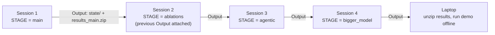

# Running on Kaggle (free GPU, laptop can sleep)

Kaggle gives you a free NVIDIA GPU for about 30 hours a week. A **committed** notebook run
("Save & Run All") keeps going on Kaggle's servers after you close your laptop, and
everything it writes is saved as that version's **Output**.

This project uses that to run **one stage per session** and **resume the next day**.



Each session restores everything from the previous Output (saved model answers, finished
runs, data), runs one stage, then saves everything again. Nothing is lost if a session
dies: commit the same stage again and finished incidents are skipped.

## One-time setup (about 15 minutes)

1. **Create a Kaggle account** at [kaggle.com](https://www.kaggle.com) and **verify your phone
   number** (Settings → Phone verification). Without it you can't turn on the GPU or the internet.
2. **Upload the project as a dataset.** Go to **Datasets → New Dataset**, drag in
   `ai-triage-assurance-lab.zip` (Kaggle unzips it), name it `ai-triage-assurance-lab`, keep it
   **Private**, and click **Create**.
   *Alternative:* once the project is on GitHub, skip this and set `GITHUB_URL` in the notebook instead.
3. **Create the notebook.** Go to **Code → New Notebook → File → Import Notebook**, and upload
   `kaggle/ai_triage_kaggle.ipynb` from the project.
4. **Notebook settings** (right-hand panel):
   - **Accelerator:** GPU T4 x2
   - **Internet:** On
   - **Add Input:** your `ai-triage-assurance-lab` dataset

## Session 1 tonight: test, then main

**First, a quick interactive test (about 5 to 10 minutes, laptop awake):**

1. Leave `STAGE = "test"` and `MODEL = "qwen2.5:7b"` in the settings cell.
2. Click **Run All**.
3. The last cell prints 5 incidents. Check that **valid JSON is True** for most, that the agent
   used tools, and that the summaries make sense.

**Then the real run (laptop can sleep):**

1. Change the settings cell to `STAGE = "main"`.
2. Click **Save Version** (top right), then **Save & Run All (Commit)**, then **Save**.
3. Close your laptop. You can watch progress any time under **Your Work → the notebook → Versions**.

## Every following session

1. Open the notebook in edit mode.
2. **Add Input → Notebook Output Files →** this notebook's **latest version**. That attaches
   yesterday's state. If an older version's output is still attached, remove it.
3. Change `STAGE` to the next one, then **Save Version → Save & Run All (Commit)**.

| Order | STAGE | MODEL | Runs |
|---|---|---|---|
| 1 | `main` | `qwen2.5:7b` | main |
| 1b | `main` again | `qwen2.5:7b` | only if you ran `main` before this update: triages just the 4 new decoy incidents (a few minutes) |
| 2 | `ablations` | `qwen2.5:7b` | payload_only, no_context, no_rag, poisoned_rag, fp_framing, no_playbook |
| 3 | `agentic` | `qwen2.5:7b` | agentic, agentic_critic, main_critic |
| 4 | `gaploop` | `qwen2.5:7b` | AI drafts, backtests and revises rules |
| 5 | `bigger_model` | `qwen2.5:14b` | main + agentic with the bigger model (names end in `__qwen2.5-14b`) |
| 5b | `heldout` | `qwen2.5:7b` | main on a second dataset (another seed): your overfitting check. Output: `results_heldout_...` |
| 6 | `repeat` | `qwen2.5:7b` | 3 repeats for pass^k (optional) |

You can combine stages in one session if the time allows; just run them one after another
with the previous output attached.

**Attach every previous output you want to keep.** The notebook merges all attached outputs, so
attaching the `main` version and the `ablations` version together carries both forward.

**`regate`** (no GPU: set Accelerator = None) re-applies the current gates to every finished run
from saved answers. Run it once after uploading a project version that changes the gates.

## Getting results onto your laptop

1. Open the latest version, go to **Output**, and download `results_<stage>.zip`. The `state/`
   folder holds the same files.
2. Unzip it into your laptop's project folder so you get `C:\ai-triage-assurance-lab\results\...`
   (choose **Replace**).
3. On the laptop:
   ```powershell
   python -m triage_lab generate      # only if data\events.jsonl is missing (same seed = same data)
   python -m triage_lab score
   python -m triage_lab demo --run main
   ```
   The demo reads the saved decisions, so no GPU or model is needed on the day. If you
   imported live Atomic Red Team events on Kaggle, also copy `state/data` into `data`.

## The agentic stage in plain words

In `agentic` runs, the AI starts with only the alert and investigates with read-only tools:
`search_events`, `get_event`, `process_tree`, `log_health`, `lookup_user` and
`search_knowledge`. It gets at most 6 tool calls, and if it can't produce a valid verdict it
falls back to the code-built evidence. The verifier and the gates still make the final
decision, checking the AI's claims against exactly the events it retrieved.

The **critic** is a second AI pass. Whenever the triage AI wants to close an incident, the
critic tries to argue it's an attack, and its objection only counts if it cites a real event
with an exact quote.

## Troubleshooting

| Problem | Fix |
|---|---|
| "Project not found" | The dataset isn't attached (Add Input), or set `GITHUB_URL` |
| "no previous state attached" on session 2+ | Attach the previous version's **Output** (Add Input → Notebook Output Files) |
| `curl: Could not resolve host` | Internet is off in notebook settings, or your phone isn't verified |
| `ollama pull` very slow | Normal for the first pull: 7B is ~4.7 GB, 14B ~9 GB. It happens once per session |
| Most incidents "valid JSON: False" | Try `qwen2.5:7b` rather than a smaller model; check `ollama.log` in Output |
| Session stopped (time limit or quota) | Commit the **same stage** again with the latest output attached: it resumes |
| GPU quota used up | Wait for the weekly reset, or run `score` (no GPU needed) |
