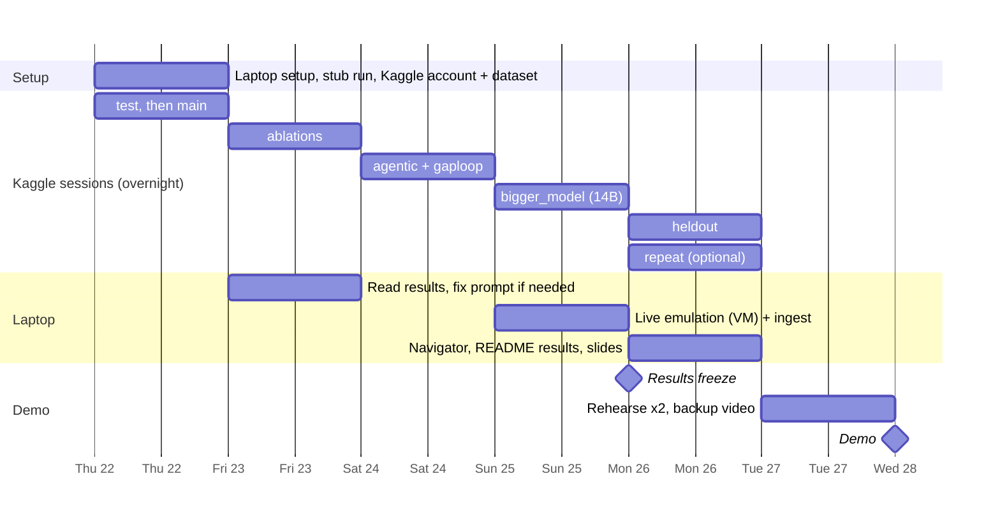

# Plan: Thursday 22 to Wednesday 28 October

Every slow model run happens **on Kaggle's free GPU, overnight**, one stage per session
(see [KAGGLE.md](KAGGLE.md)). Your days are for checking results, the live emulation, and
preparing the demo. Each Kaggle session saves its state, so the next one resumes where the
last stopped.

| Day | You (daytime) | Kaggle (overnight) | Checkpoint by end of day |
|---|---|---|---|
| **Thu 22** | Laptop Step 0 and stub run; Kaggle account, phone verified, dataset uploaded, notebook imported; `STAGE = "test"` interactively | Commit `STAGE = "main"` | Test shows valid JSON and tool use on 5 incidents |
| **Fri 23** | Download results; read 10 answers by eye; `score` on laptop | Commit `ablations` | `main` scored with real numbers |
| **Sat 24** | Score; draft the results section | Commit `agentic`, then `gaploop` if time remains | Ablations scored |
| **Sun 25** | Live emulation in the VM (2-3 Atomic Red Team tests), ingest; re-upload the updated `data` folder with the dataset, or run `ingest-windows` in the notebook | Commit `bigger_model` with `MODEL = "qwen2.5:14b"` | Agentic and critic results scored |
| **Mon 26** | Final `score`; Navigator layer + screenshot; README results; slides | `heldout`, then `repeat` (optional) | **Results freeze** |
| **Tue 27** | Rehearse `demo` twice on the laptop (replays saved results); record backup video; push to GitHub | n/a | Demo runs in under a minute offline |
| **Wed 28** | Morning check, then **demo** | n/a | Done |

## If you fall behind

Cut in this order:

1. `repeat` (pass^k): future work.
2. `bigger_model`: future work, or run `main` only with 14B.
2b. `heldout`: keep it if you can; it answers "did you just tune the prompt to your own data?"
3. Live emulation: one technique, or future work.
4. Ablations: keep `payload_only`, `no_context` and `fp_framing` (`--only` picks runs).

**Never cut:** `main`, `agentic` (it's your differentiator now), scoring, the rehearsal and the backup video.
