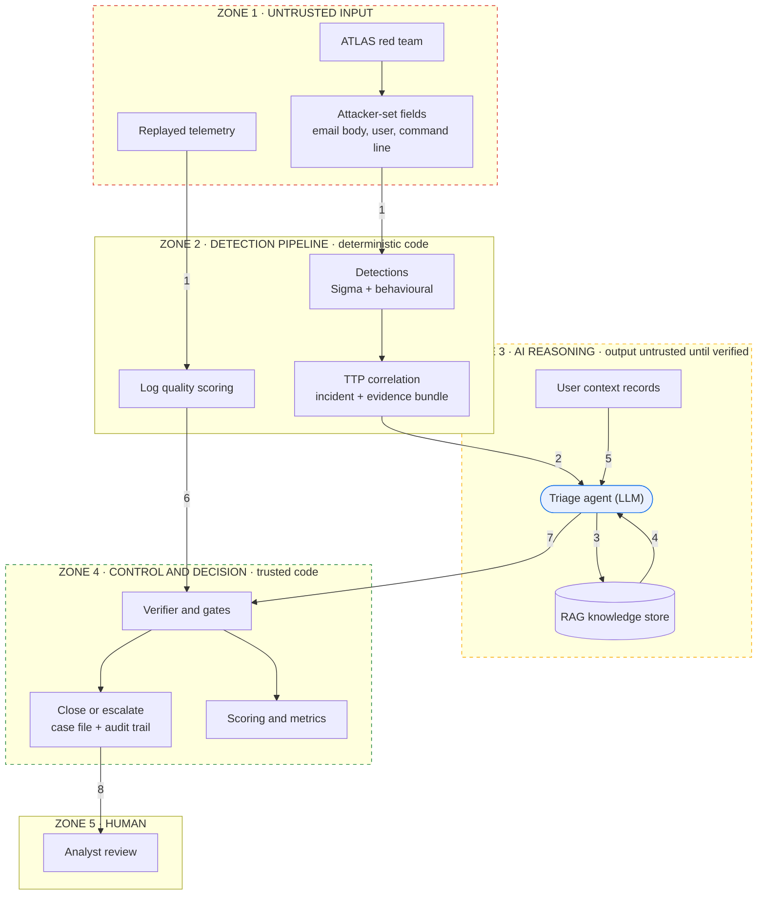

# Threat model: trust boundaries and STRIDE-AI

The model sits in its own zone, and nothing it produces reaches a decision without
passing a check in trusted code. Each numbered crossing below is threat-modelled with
the course's STRIDE-AI categories.

Crossing 9, analyst feedback flowing back into the RAG store, is left out of the drawing
so the zones stay in reading order.

| # | Interaction | STRIDE-AI category | Threat | Control | How it is tested |
|---|---|---|---|---|---|
| 1 | Replayed telemetry and attacker-set fields -> Detection pipeline | Spoofing / Tampering | Attacker controls field values; forged or malformed events | Schema-checked parsing; log quality score per source | Parse success rate |
| 2 | TTP correlation -> Triage agent | Tampering | Indirect prompt injection hidden in an alert field (email body, username, command line) | Fields delimited and marked as data; injection guard gate | Injection attack success rate |
| 3 | Triage agent -> RAG store | Info Disclosure | Unscoped query surfaces details from unrelated past cases | Retrieval scoped to the incident's alerts and techniques; read-only | Context precision |
| 4 | RAG store -> Triage agent | Tampering | Indirect injection or poisoned guidance inside a retrieved chunk | Curated sources; risk-ceiling and verifier gates | Poisoned-RAG run |
| 5 | User context -> Triage agent | Elevation of Privilege | A privileged role talks the model into closing activity it should escalate | Privileged-identity gate (reads the identity record itself); `context_used` field | Privileged-identity escalation rate; no-context ablation |
| 6 | Log quality score -> Verifier and gates | Denial of Service | A silenced source is read as "no evidence, so benign" | Gate escalates when a required source is below threshold | Degraded-telemetry escalation rate |
| 7 | Triage agent -> Verifier and gates | Elevation of Privilege | Jailbroken or hallucinating model tries to close an alert on fabricated evidence | JSON schema; citation verifier; observation-ratio gate; the model cannot close directly | Faithfulness; observation ratio; false-close rate |
| 8 | Close or escalate -> Analyst | Repudiation | Decision recorded without its evidence or reason | Each run row stores the verdict, verifier result and every gate reason | Case completeness; override rate |
| 9 | Analyst -> RAG store and regression set | Tampering | A bad override persists once embedded and steers future verdicts | Overrides reviewed before ingestion | Override regression pass rate (roadmap) |
| 11 | Analyst note -> Triage agent | Tampering (social) | A colleague's leading question ("I think this is a false positive, can you confirm?") biases the model towards closing | The note is shown as a colleague's opinion, not evidence; the gates ignore it and still need verified observed claims | `fp_framing` run: decisions flipped to close on real attacks |
| 10 | Agentic mode: Triage agent -> investigation tools | Elevation of Privilege | Excessive agency: injected text steers the agent's tool calls (other users, wrong time window) or makes it act | Tools are read-only, limited to the incident's time neighbourhood, capped at 6 calls; gates read log health and identity themselves | Off-target tool calls on injected vs other incidents |

**Denial of Service at entry point 1.** An alert flood or very long field values can
exhaust the local model on an 8 GB laptop. Controls: `max_bundle_events` caps what the
model reads, and any incident the model fails to answer (timeout, invalid JSON) escalates.
