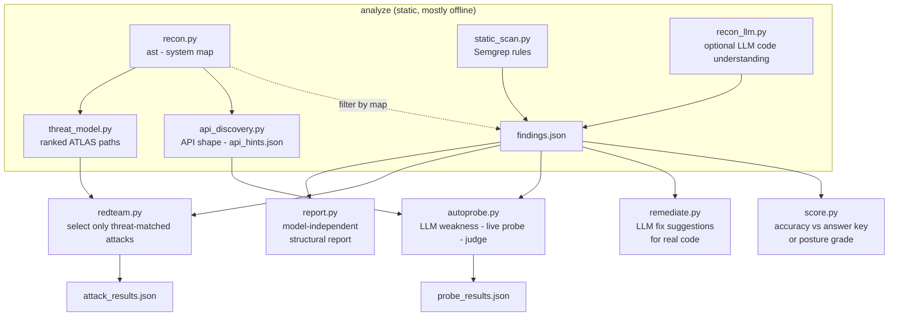

# Sentinel - Architecture

Sentinel is a pipeline of small, single-purpose agents. Each one does one job, writes a
plain JSON/Markdown artifact, and hands off to the next. Nothing is a black box: every
intermediate result is a file you can open in `runs/<app-name>/`.

---

## Design principles

1. **Threat-model-gated work.** Recon and a rules-based threat model run first and decide
   which attack families are even *possible* for the app under review. Downstream stages
   (attacks, probes) only act on those families. This keeps token cost proportional to the
   app's real attack surface instead of blasting every known jailbreak at every app.

2. **Model-independent findings.** The headline report is about *structural* controls -
   code and design guardrails that hold no matter how strong the model is (e.g. a
   recipient allow-list on an email tool, labelling untrusted tool output, keeping user
   text out of the system prompt). A prompt-only mitigation that passes on a frontier
   model often fails on a cheaper one, so Sentinel verifies fixes against a deliberately
   **weak** model.

3. **Untrusted code is data.** Sentinel reads the *target's* source. That source is never
   trusted as instructions: the LLM stages wrap it in untrusted-content tags, demand a
   strict JSON schema back, and run under a hard token budget (`sentinel/llm.py`).

4. **Self-configuring.** For a web app, static analysis also discovers the chat API shape
   so dynamic probing needs little or no hand configuration.

---

## The pipeline



`scan` runs the whole chain in one command. Each stage is also a standalone subcommand.

---

## Stage by stage

### 1. Recon - `agents/recon.py`
Parses the target with Python's `ast` to build a **system map**: LLM call sites (SDK calls
and raw HTTP calls that look like chat completions), prompts, tools (decorated functions
and side-effecting calls), agents, and entry points. No LLM - fast and deterministic.
Written to `system_map.json`.

### 2. Threat model - `agents/threat_model.py`
Turns the system map into a ranked set of **MITRE ATLAS** attack paths, scored by the
surface the app actually exposes, and renders a data-flow diagram. Optionally re-rated by
the LLM using a *compact* summary of the map (not the whole thing) to keep cost bounded.

### 3. Static scan - `agents/static_scan.py` + `checks/rules/core.yaml`
Runs **Semgrep** rules (one or two per family) over the source. Results are filtered
against the system map (e.g. a "side-effect tool with no guard" finding is dropped if the
function isn't actually a reachable tool), de-duplicated, and optionally triaged by the
LLM - non-destructively, bounded to the highest-severity findings. Produces `findings.json`.

### 4. LLM code understanding - `agents/recon_llm.py` (optional)
When `SENTINEL_LLM=anthropic`, reads the most security-relevant files (ranked, then passed
through the **source reducers** in `reducer/` so only signatures and security-relevant
bodies survive) and proposes weaknesses the rules missed, each with a suggested probe.

### 5. API discovery - `agents/api_discovery.py`
Zero-token, zero-network static read of README / Dockerfile / compose / source and any
example request bodies (`curl`, `fetch`, tests) to infer the app's **port, chat endpoint,
request fields, and reply path**. The most reliable signal is a *coupled* example where a
URL, port, and JSON body appear together. It rejects noise (log-record schemas, negative
test fixtures, streaming/test-only routes) and writes `api_hints.json`.

### 6. Report - `agents/report.py`
The headline deliverable: a **model-independent structural weakness report**. For each
family it states the missing control, why it matters, and the code-level fix, mapped to
OWASP + ATLAS.

### 7. Red team - `agents/redteam.py` + `attacks/corpus.yaml`
`select()` keeps only the attacks whose family the threat model/static scan flagged (plus
a small baseline), then runs them through the harness. This is the "attack only what's
possible" step.

### 8. Auto-probe - `agents/autoprobe.py`
Closes the loop on LLM-proposed weaknesses: generates one concrete single-turn probe per
weakness, runs it against the live app, and an **LLM-as-judge** decides whether the bad
outcome occurred. Confirmed weaknesses become evidence with a transcript. `--safe` skips
write-risky probes and flags any that trigger a real tool call.

### 9. Remediate - `agents/remediate.py`
The fix stage, LLM-driven and general to **any** codebase - there is no hardcoded, per-app fix
table. For each confirmed or high-severity finding it reads the real faulty source, asks a model for
a fix anchored to the family's model-independent control, and validates the suggestion **without
modifying the target**: the fix's anchors must exist in the real file and the patched Python must
still compile, or it is flagged and marked low confidence. It writes `remediation.md` (diagnosis,
the diff, rationale, verification steps) and `suggested_fixes/<id>.patch`. The faulty code is
wrapped as untrusted data in the prompt, and a shaky suggestion is reported honestly rather than
silently trusted. You review and apply the patches yourself - so the same flow works on a real
application, not just a demo with known flaws.

### 10. Score - `score.py`
With an `answer_key.yaml` (the practice app) it reports recall/precision. Without one (a
real app) it reports a **security posture grade**: severity-weighted risk, per-weakness
confidence, and scan coverage - never accuracy it can't measure.

---

## The harness - `harness/`

- **`sandbox.py`** runs a single target case in isolation (local subprocess or Docker),
  with sandbox files copied fresh each run.
- **`oracles.py`** are plain-code pass/fail checks (canary strings, forbidden recipients,
  regex) plus an LLM-as-judge for behavioral outcomes.
- **`http_adapter.py`** talks to a running web app and is how Sentinel reviews real
  services. It can `verify` an endpoint (send one benign message and classify the
  response), `discover` one from a base URL, and `probe_endpoint` to distinguish a correct
  endpoint that merely errored (e.g. the app's own backend is down) from a wrong URL.

### `sentinel.http.json` schema

Drop this next to a target to describe its chat API explicitly (auto-discovery writes one
for you when it can):

```json
{
  "url": "http://localhost:8000/api/chat",
  "message_field": "message",
  "extra_body": { "history": [] },
  "reply_path": "response",
  "actions_path": "actions_executed",
  "headers": {},
  "method": "POST",
  "timeout": 90
}
```

- `message_field` - the request field that carries the user message.
- `extra_body` - any other required request fields (ids, thread ids, history).
- `reply_path` - dotted path to the reply text in the response JSON (e.g.
  `choices.0.message.content`).
- `actions_path` - dotted path to a list of tool/actions the app executed, if exposed.

---

## Knowledge base - `kb/`

- `families.yaml` - the six check families and their OWASP/ATLAS mappings. Single source
  of truth read by the rules, attack selection, and the report.
- `controls.yaml` - the model-independent control for each family (statement, rationale,
  code fix).
- OWASP LLM 2026, OWASP Agentic 2026, and the ATLAS subset used for tagging.

---

## Safety model

- **Instruction/data separation:** target source and tool output are always treated as
  data, never as instructions to Sentinel's own agents.
- **Token budgets:** every LLM stage runs under a hard budget; expensive steps use
  reduced/compacted inputs.
- **`--safe` by default for live apps:** write-risky probes are skipped unless you opt in,
  and any real tool execution during a probe is surfaced explicitly.
- **Fixes are suggestions, not silent rewrites:** remediate validates each patch (anchors exist,
  code compiles) and emits verification steps; it never modifies your code.
